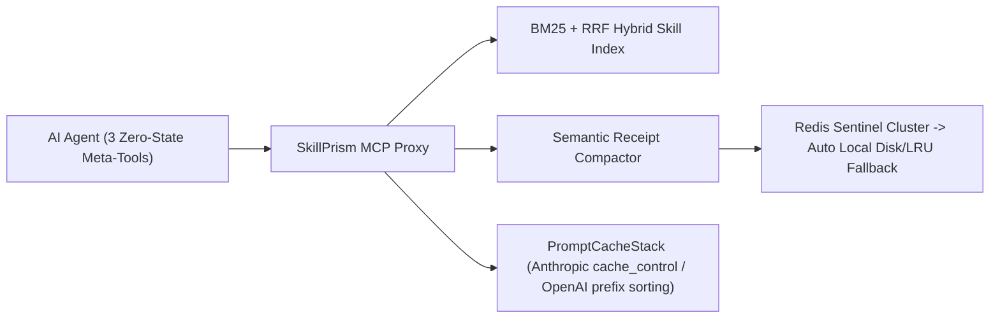

# 02 — SkillPrism Architecture

## Key Subsystems
1. **Zero-State JIT Harness**: Replaces 50+ preloaded MCP tool schemas with 3 lightweight meta-tools (`search_skills`, `load_skill`, `inspect_receipt`) and emits real-time `notifications/tools/list_changed` updates.
2. **Semantic Receipt Compactor**: Stores heavy tool payloads out-of-context and returns compact semantic receipts with field-level `inspect_receipt` access.
3. **Resilient Redis Sentinel Routing (`src/redis-sentinel.ts`)**: Automatically fails over to a bounded local disk-backed LRU store (`local-sqlite-lru` / `local-memory-lru`) with zero errors if Redis Sentinel is stopped or partitioned.
4. **Prompt Cache Stacking (`src/prompt-cache-stack.ts`)**: Stacks Anthropic `cache_control: ephemeral` and OpenAI deterministic prefix sorting on top of JIT pruning for 98%+ effective token reduction with OpenTelemetry FinOps metrics.
